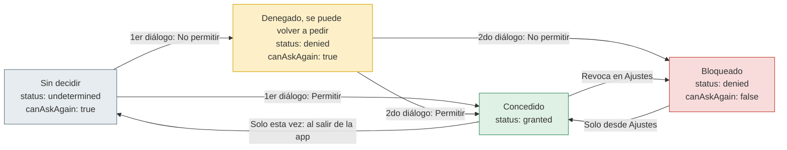
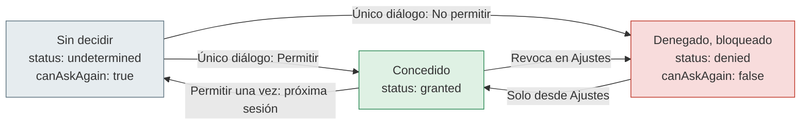

# Trabajo práctico 3: Permisos

*TSDSM 2 - Taller Complementario React Native II*

**Fabiana Rossi**
23 de octubre de 2026

---

# Parte A: respuestas

## A1. Conceptos

**a)** Un permiso es la autorización que la persona usuaria le da a la app a acceder a recursos sensibles del dispositivo.

- **App**: La app cumple la función de declarar los recursos que podría necesitar y en el momento justo lo pide.
- **Sistema operativo**: Se encarga de mostrar el diálogo del permiso, de guardar la decisión y hacerla cumplir.
- **Persona usuaria**: Acepta o rechaza los permisos y puede modificar su decisión en ajustes.

**b)** La caja de arena (sandbox) es un espacio aislado donde la app solo ve sus archivos, y para acceder a los demás recursos del dispositivo necesita una llave, esa llave son los permisos. Una app sin permisos solo puede utilizar recursos que trae de ella misma.

**c)**

1. **Privacidad**: Las fotos no salen sin el permiso del usuario.
2. **Transparencia**: El sistema muestra qué app usa qué.
3. **Seguridad**: Si una app maliciosa entra al dispositivo solo daña lo que se le permitió.
4. **Control**: La decisión puede ser revocada desde ajustes.

**d)** <u>Visita</u>: la app. <u>Portero</u>: el sistema operativo. <u>Dueño</u>: el usuario. Cuando dice que el portero se acuerda de la respuesta, se refiere a que la guarda y la hace cumplir.

## A2. Declarar y solicitar

|  | Declarar (al compilar) | Solicitar (al ejecutar) |
|---|---|---|
| ¿Qué se hace? | Le avisás al sistema qué recursos puede usar la app | Cuando la persona usa la función el sistema le pide acceso y el sistema muestra el diálogo |
| ¿Dónde / cómo en Android? | Una línea `<uses-permission>` en androidManifest.xml | Solo para los permisos en tiempos de ejecución |
| ¿Dónde / cómo en iOS? | Un texto de propósito en info.plist | Para cada recurso protegido |
| ¿Dónde / cómo en Expo? | Los dos archivos se generan en app.json | `request…permissionAsync()` o l hook del módulo |
| ¿Qué pasa si se omite? | No se puede pedir | No se puede obtener |

## A3. Verdadero o falso

- **a)** Falso. El diálogo lo dibuja el sistema operativo y no la app. La app solo elige el momento de pedirlo y el texto de propósito.
- **b)** Verdadero.
- **c)** Falso. El info.plist es un archivo nativo, así que un cambio ahí exige una nueva build y publicarla en la tienda pues una actualización OTA solo reemplaza el código JavaScript y los assets, no la configuración nativa.
- **d)** Falso. Si el permiso no está declarado en el manifiesto, Android no muestra el diálogo. Sin declaración no hay pedido.
- **e)** Falso. Expo-permissions está obsoleto y ya no se usa, ahora cada módulo trae sus propias funciones y hooks.
- **f)** Verdadero.
- **g)** Verdadero.
- **h)** Verdadero.

## A4. Los estados de un permiso

**Android:**



**iOS:**



La diferencia entre las dos plataformas radica en cuando le decimos que rechazamos los servicios. En android, se puede volver a preguntar pero en iOS directamente no deja que el diálogo vuelva a aparecer y se tendrá que modificar en ajustes si cambiamos de opinión.

**b)**

| Estado | Status | canAskAgain | ¿Puede aparecer el diálogo? |
|---|---|---|---|
| Sin decidir | undetermined | true | Sí |
| Concedido | granted | true | No hace falta |
| Denegado (se puede volver a pedir) | denied | true | Sí |
| Bloqueado | denied | false | No |

---

# Parte B: respuestas

## B1. Clasificar los permisos

| Permiso | Tipo | ¿Cómo se obtiene? |
|---|---|---|
| `internet` | De instalación | Automáticamente al instalar la app |
| `camera` | En tiempo de ejecución | Mediante un diálogo mientras se usa la app |
| `vibrate` | De instalación | Automáticamente al instalar la app |
| `system_alert_window` | Especiales | La persona lo activa desde ajustes |
| `post_notifications` | En tiempo de ejecución | Mediante un diálogo mientras se usa la app |
| `access_network_state` | De instalación | Automáticamente al instalar la app |
| `read_contacts` | En tiempo de ejecución | Mediante un diálogo mientras se usa la app |
| `schedule_exact_alarm` | Especiales | La persona lo activa desde ajustes |
| `record_audio` | En tiempo de ejecución | Mediante un diálogo mientras se usa la app |
| `manage_external_storage` | Especiales | La persona lo activa desde ajustes |

## B2. Grupos y nombres

**a)** Un grupo de permisos reúne permisos relacionados con el mismo recurso. SI la app pide los dos juntos, la persona ve un solo diálogo.

**b)** El prefijo es `android.permission`. Se escribe antes del nombre corto del permiso.

El nombre completo del permiso de cámara es `android.permission.CAMERA`.

**c)** Los permisos de firma son permisos que el sistema sólo concede si la app está firmada con el mismo certificado que la app o el sistema que definió ese permiso. No se usan en apps comunes porque una app de terceros no comparte certificado con el sistema ni con otras empresas así que nunca los obtendría.

## B3. leer el manifiesto

**a)** Se concede solo al instalar: internet,

Hay que pedirlo en tiempo de ejecución: Camera, access_coarse_location, access_fine_location y post_notifications. También read_external_storage en android 12 o anterior.

**b)** `android:maxSdkVersion="32"` significa que esa declaración solo vale hasta la API 32. Desde la API 33 el permiso se ignora así que no se pide.

Los permisos que reemplazan a read_external_storage son read_media_images, read_media_video y read_media_audio.

**c)** `tools:node="remove"` le dice al fusionador de manifiestos que saque ese permiso del manifiesto final aunque una librería lo declare.

El fragmento de app.json que lo genera es:

```json
{
  "expo": {
    "android": {
      "blockedPermissions": ["android.permission.RECORD_AUDIO"]
    }
  }
}
```

**d)** schedule_exact_alarm va en `expo.android.permissions`, que es la propiedad para declarar permisos que ninguna librería agrega.

```json
{
  "expo": {
    "android": {
      "permissions": ["android.permission.SCHEDULE_EXACT_ALARM"]
    }
  }
}
```

**e)** No conviene editarlo a mano porque android/ es un resultado generado: cada `npx expo prebuild` lo genera a partir de app.json, lo que se escriba directo en el AndroidManifest.xml se pierde.

BlockedPermissions no funciona en expo go, pues expo go es una app ya compilada con su propio manifiesto. Las configuración nativa sólo se aplica en una development build.

## B4. Así pregunta Android

**a)** No. El cartel que muestra Android es responsabilidad exclusiva del SO y no admite ningún mensaje personalizado. Si querés dar explicaciones, tenés que mostrar una pantalla propia antes de lanzarlo.

**b)** "Mientras la app está en uso" concede un permiso persistente pero limitado al primer plano. En cambio, "Solo esta vez" otorga un acceso temporal que se pierde un ratito después de cerrar la aplicación. Además, esta alternativa únicamente aparece al solicitar ubicación, cámara o micrófono.

**c)** El sistema operativo no vuelve a enseñar el cartel y el permiso queda denegado definitivamente, marcando `canAskAgain` como `false`.

**d)** Para "farmacias de tu zona" es suficiente, ya que únicamente requiere una ubicación aproximada. Sin embargo, no alcanza para "llegar caminando a la puerta", pues ese caso exige precisión exacta.

El sistema operativo mata la ejecución de la app inmediatamente. Al abrirla nuevamente, el flujo inicia completamente desde el principio.

## B5. Android, versión por versión

| Cambio | Versión (API) | Qué implica para el código |
|---|---|---|
| Nacen los permisos en tiempo de ejecución | Android 6.0 (API 23) | El código tiene que contemplar que un permiso puede no estar. |
| La ubicación en segundo plano pasa a ser un permiso aparte | Android 10 (API 29) | Se pide con `requestBackgroundPermissionsAsync()`, siempre después del pedido de primer plano. |
| Dos rechazos equivalen a "no volver a preguntar" | Android 11 (API 30) | `canAskAgain` pasa a `false` después del segundo rechazo: hay que ofrecer Ajustes. |
| Ubicación precisa o aproximada | Android 12 (API 31) | Se lee `android.accuracy`, que vale `"fine"` o `"coarse"`, y la app tiene que funcionar con las dos. |
| Las notificaciones pasan a ser un permiso (`POST_NOTIFICATIONS`) | Android 13 (API 33) | Hay que crear el canal y pedir el permiso en un momento con sentido. |
| Acceso parcial a fotos y videos ("Seleccionar fotos") | Android 14 (API 34) | `accessPrivileges` puede valer `"limited"` también en Android. |
| Permiso de red local (`ACCESS_LOCAL_NETWORK`) | Android 17 (API 37) | Aplica a apps con target API 37, así que llega con las próximas versiones del SDK. |

El `targetSdkVersion` es la versión de Android para la que la app declara estar preparada. Muchos cambios de comportamiento se aplican según ese valor. Expo SDK 57 apunta a la API 36, y Google Play exige API 36 para apps nuevas y actualizaciones desde el 31 de agosto de 2026.

---

# Parte C: respuestas

## C1. Claves del Info.plist

| Recurso | Clave en Info.plist |
|---|---|
| Cámara | `NSCameraUsageDescription` |
| Micrófono | `NSMicrophoneUsageDescription` |
| Ubicación en uso | `NSLocationWhenInUseUsageDescription` |
| Ubicación siempre | `NSLocationAlwaysAndWhenInUseUsageDescription` |
| Fotos (leer) | `NSPhotoLibraryUsageDescription` |
| Fotos (solo guardar) | `NSPhotoLibraryAddUsageDescription` |
| Contactos | `NSContactsUsageDescription` |
| Face ID | `NSFaceIDUsageDescription` |
| Rastreo entre apps (ATT) | `NSUserTrackingUsageDescription` |
| Notificaciones | No lleva clave: se piden directamente. |

## C2. Sin texto, no hay permiso

**a)** Si falta el texto de propósito y la app intenta usar la cámara, la app se cierra. Al subir la build a App Store Connect, la rechaza con el error `ITMS-90683: Missing purpose string in Info.plist`.

**b)** iOS muestra el diálogo una sola vez. Si la persona dice que no, la decisión queda guardada y a la app solo le queda ofrecer una alternativa y mandar a Ajustes con `Linking.openSettings()`.

**c)** El título lo arma el sistema con el nombre de la app y no se puede cambiar. El texto de propósito lo escribo yo. En Expo se configura en el plugin de cada módulo o en `ios.infoPlist` dentro de app.json.

**d)** Pasa porque la librería usa una API protegida, aunque la app nunca la llame, y Apple detecta que falta el texto de propósito. Se resuelve agregando el texto de esa clave en el plugin o en `ios.infoPlist` y volviendo a compilar.

## C3. Probador de textos de propósito

| Texto propuesto | ¿Aprobado? | Versión mejorada |
|---|---|---|
| "Necesitamos tu ubicación." | No, no dice para qué se usa. | "Usamos tu ubicación para mostrarte los puntos de reciclaje de tu barrio." |
| "Para mejorar tu experiencia." | No, es demasiado vago. | "Usamos tu ubicación para avisarte qué colectivo te conviene tomar." |
| "Usamos tu ubicación para mostrarte las farmacias de turno más cercanas." | Sí, sigue el molde con un beneficio concreto. | No hace falta cambiarlo. |
| "La app no funciona sin ubicación." | No, presiona en vez de explicar el beneficio. | "Usamos tu ubicación para calcular cuánto tarda tu pedido en llegar." |
| "Ubicación requerida por el sistema." | No, es engañoso: el sistema no la requiere, la pide la app. | "Usamos tu ubicación para mostrarte los comercios que tenés cerca." |

## C4. Acceso parcial y gradual

| Caso | iOS | En Expo |
|---|---|---|
| Fotos limitadas ("Seleccionar fotos") | iOS 14 | `accessPrivileges: 'limited'` |
| Ubicación aproximada (interruptor "Precisa") | iOS 14 | `ios.accuracy: 'reduced'` |
| "Permitir una vez" (ubicación) | iOS 13 | Expo responde `granted` hasta la próxima sesión; después vuelve a `undetermined`. |
| Ubicación escalonada: de "al usar la app" a "Siempre" | iOS 13 | `requestForegroundPermissionsAsync()` y después `requestBackgroundPermissionsAsync()` |
| Notificaciones provisionales | iOS 12 | `ios: { allowProvisional: true }` en `requestPermissionsAsync()` |
| Rastreo entre apps (App Tracking Transparency) | iOS 14.5 | `expo-tracking-transparency` con `useTrackingPermissions()` |

Expo SDK 57 requiere iOS 16.4 o superior. En la práctica, todos los casos de la tabla (que son de iOS 14.5 o anteriores) ya aplican a cualquier persona que use la app.

## C5. Android vs iOS, lado a lado

|  | Android | iOS |
|---|---|---|
| ¿Dónde se declara? | `<uses-permission>` en el manifiesto | Texto de propósito en el Info.plist |
| Texto en el diálogo | Lo arma el sistema | Lo escribe quien desarrolla |
| Oportunidades para preguntar | Dos rechazos y se bloquea (Android 11+) | Una sola |
| "Solo esta vez" / "Permitir una vez" | Ubicación, cámara y micrófono | Solo ubicación ("Permitir una vez") |
| Notificaciones | Permiso de tiempo de ejecución desde Android 13 | Siempre se piden (o provisionales) |
| Ubicación en segundo plano | Se concede desde Ajustes (Android 11+) | Segundo pedido para pasar a "Siempre" |
| Si falta la declaración | Se deniega sin mostrar diálogo | Falla o se cierra la app, y la tienda rechaza la build |

---

# Parte D: respuestas

## D1. Módulos y funciones

| Necesidad | Módulo | Hook / función de permiso |
|---|---|---|
| Escanear un QR con la cámara | `expo-camera` | `useCameraPermissions()` |
| Grabar video con sonido | `expo-camera` | `useCameraPermissions()` y `useMicrophonePermissions()` |
| Mostrar farmacias cercanas | `expo-location` | `useForegroundPermissions()` |
| Seguir un envío con la app en segundo plano | `expo-location` | `useBackgroundPermissions()` (después del de primer plano) |
| Mostrar un recordatorio | `expo-notifications` | `getPermissionsAsync()` / `requestPermissionsAsync()` |
| Grabar una nota de voz | `expo-audio` | `requestRecordingPermissionsAsync()` |
| Galería propia dentro de la app | `expo-media-library` | `usePermissions()` |
| Publicidad personalizada entre apps (iOS) | `expo-tracking-transparency` | `useTrackingPermissions()` |

Si un tutorial importa `expo-permissions`, el tutorial está desactualizado: ese paquete ya no existe y cada módulo maneja sus propios permisos.

## D2. Consultar, pedir y el hook

**a)** `get…PermissionsAsync()` solo consulta el estado actual y nunca muestra un diálogo. `request…PermissionsAsync()` es la que pide el permiso y la que puede mostrar el diálogo del sistema.

**b)** El hook devuelve la respuesta actual (`permiso`), la función que pide el permiso (`pedirPermiso`) y la función que vuelve a consultar sin pedir (`consultarPermiso`). En el primer render `permiso` vale `null`, porque el hook todavía está consultando. Mientras tanto, la pantalla tiene que mostrar un indicador de carga.

**c)** Si `canAskAgain` es `false`, `request…()` vuelve al instante sin mostrar nada. Si se la llama en un bucle (o en cada render), la pantalla se queda en "Pidiendo permiso…" para siempre.

## D3. Leé la respuesta

| Respuesta | Qué hace la app |
|---|---|
| `null` | El hook todavía consulta: muestra un indicador de carga. |
| `{ status: 'granted', granted: true }` | Usa la función. |
| `{ status: 'undetermined', canAskAgain: true }` | Explica el beneficio y ofrece un botón "Continuar" que llame a pedir. |
| `{ status: 'denied', canAskAgain: true }` | Muestra una alternativa y la opción de volver a intentar. |
| `{ status: 'denied', canAskAgain: false }` | Explica cómo habilitarlo y abre Ajustes con `Linking.openSettings()`. |
| `{ status: 'granted', accessPrivileges: 'limited' }` | Trabaja con la selección y ofrece ampliarla, sin insistir. |
| `{ status: 'granted', android: { accuracy: 'coarse' } }` | Funciona con la ubicación aproximada: muestra resultados por zona y no distancias exactas. |

Los dos campos que deciden casi todo son `granted`, que responde "¿lo uso?", y `canAskAgain`, que responde "¿lo pido o mando a Ajustes?".

## D4. Simulación del ciclo completo

| # | Acción | status | canAskAgain | ¿Diálogo? |
|---|---|---|---|---|
| 1 | `getForegroundPermissionsAsync()` | undetermined | true | No |
| 2 | `requestForegroundPermissionsAsync()` → "No permitir" | denied | true | Sí |
| 3 | `requestForegroundPermissionsAsync()` → "No permitir" | denied | false | Sí |
| 4 | `requestForegroundPermissionsAsync()` | denied | false | No |
| 5 | `Linking.openSettings()` → habilita "Mientras la app está en uso" → vuelve y la app consulta | granted | true | No |
| 6 | Igual que el 5, pero la app no vuelve a consultar | La pantalla sigue mostrando "bloqueado", aunque el permiso ya está concedido. | | |

En iOS el resultado cambia en el paso 2: iOS pregunta una sola vez, así que el primer "No permitir" ya deja `denied` con `canAskAgain: false`. Por eso el paso 3 ya no muestra diálogo. Si la persona elige "Permitir una vez" y después cierra y reabre la app, el estado vuelve a `undetermined` y el diálogo puede aparecer de nuevo.

## D5. Configurar app.json

```json
{
  "expo": {
    "plugins": [
      [
        "expo-camera",
        {
          "cameraPermission": "Usamos tu cámara para leer los códigos QR.",
          "microphonePermission": false,
          "recordAudioAndroid": false
        }
      ],
      [
        "expo-location",
        {
          "locationWhenInUsePermission":
            "Usamos tu ubicación para mostrarte los puntos de reciclaje cercanos."
        }
      ]
    ],
    "android": {
      "blockedPermissions": ["android.permission.SYSTEM_ALERT_WINDOW"]
    }
  }
}
```

expo-camera agrega RECORD_AUDIO en Android aunque la app no grabe sonido porque por defecto `recordAudioAndroid` vale `true`: la cámara también puede grabar video con audio.

## D6. Expo Go no es tu app

**a)** Porque Expo Go es una app ya compilada, con su propio Info.plist y su propio manifiesto. Los diálogos que se ven son los de Expo Go y no se aplican los textos de propósito ni la lista de permisos de mi app.json.

**b)** En Expo Go se puede probar la lógica: estados, botones, ir a Ajustes, alternativas y notificaciones locales. Hace falta una development build para las notificaciones push en Android (desde SDK 53), para la ubicación en segundo plano, y para ver mis textos y el manifiesto real.

**c)** Para ver los archivos nativos generados: `npx expo prebuild`.

Para compilar una development build en Android: `npx expo run:android` (o `eas build --profile development --platform android`).

**d)** En Android: `adb shell pm revoke <paquete> android.permission.ACCESS_FINE_LOCATION`.

En el simulador de iOS: `xcrun simctl privacy booted reset location <bundle id>`.

---

# Parte E: respuestas

## E1. Encontrá los errores (cámara)

Errores encontrados:

1. `permiso` vale `null` en el primer render y el código lee `permiso.status`: la app se rompe.
2. Falta el estado bloqueado: si `canAskAgain` es `false`, el botón no hace nada y la persona queda sin salida. Falta "Abrir Ajustes".
3. El botón dice "Permitir" en lugar de "Continuar": el permiso lo da el sistema, no ese botón.
4. Compara el texto `status` cuando alcanza con `granted`, y pasa `pedirPermiso` directo a `onPress` en vez de envolverlo en una función.

Versión corregida (cargando → concedido → preguntable → bloqueado):

```tsx
import { CameraView, useCameraPermissions } from 'expo-camera';
import { ActivityIndicator, Button, Linking, Text, View } from 'react-native';

export default function Escanear() {
  const [permiso, pedirPermiso] = useCameraPermissions();

  if (permiso === null) {
    return <ActivityIndicator />;
  }

  if (permiso.granted) {
    return <CameraView style={{ flex: 1 }} facing="back" />;
  }

  if (permiso.canAskAgain) {
    return (
      <Explicacion texto="Usamos la cámara para leer el QR del aula.">
        <Button title="Continuar" onPress={() => pedirPermiso()} />
      </Explicacion>
    );
  }

  return (
    <View>
      <Text>La cámara está bloqueada. Podés habilitarla en Ajustes.</Text>
      <Button title="Abrir Ajustes" onPress={() => Linking.openSettings()} />
    </View>
  );
}
```

## E2. El orden importa (ubicación)

**a)** Está mal el orden: pide segundo plano antes que primer plano. En iOS, el sistema primero pregunta "al usar la app". En Android 11+ no se obtiene el permiso y además el pedido abre Ajustes sin contexto. También devuelve `false` aunque el primer plano haya sido concedido.

**b)** Reescribo la función con el orden correcto:

```ts
export async function activarSeguimiento() {
  const enUso = await Location.requestForegroundPermissionsAsync();
  if (!enUso.granted) return false;

  const siempre = await Location.requestBackgroundPermissionsAsync();
  return siempre.granted;
}
```

**c)** Función que devuelve las coordenadas y si la ubicación es aproximada, o `null` si se deniega:

```ts
export async function obtenerUbicacion() {
  try {
    const permiso = await Location.requestForegroundPermissionsAsync();
    if (!permiso.granted) return null;

    const posicion = await Location.getCurrentPositionAsync();
    const aproximada =
      permiso.android?.accuracy === 'coarse' ||
      permiso.ios?.accuracy === 'reduced';

    return { coords: posicion.coords, aproximada };
  } catch {
    return null;
  }
}
```

**d)** No, para "farmacias cercanas" alcanza con primer plano. Si se pide segundo plano, Google Play exige una declaración especial de permisos, con un aviso visible en la app y un video.

## E3. Notificaciones mudas

**a)** La causa más probable es que no existe ningún canal de notificaciones. En Android 13+ el diálogo no aparece hasta que exista al menos un canal. Antes de pedir el permiso hay que crearlo con `Notifications.setNotificationChannelAsync()`.

**b)** En Android 12 o anterior las notificaciones vienen habilitadas y el pedido responde sin mostrar diálogo.

**c)** Las notificaciones provisionales, con `allowProvisional: true`. Llegan en silencio al Centro de notificaciones, sin diálogo previo. En el código se detecta cuando `ios.status` de la respuesta vale `Notifications.IosAuthorizationStatus.PROVISIONAL`.

**d)** Conviene pedirlo después de una acción con sentido. Buen momento: cuando la persona toca "Avisame cuando mi pedido esté listo". Mal momento: apenas abre la app por primera vez.

## E4. Fotos sin pedir permiso

| Necesidad | Herramienta | Permiso |
|---|---|---|
| Elegir una foto de perfil | `ImagePicker.launchImageLibraryAsync` | Ninguno |
| Sacar una foto en el momento | `ImagePicker.launchCameraAsync` o `expo-camera` | Cámara |
| Editor que muestra toda la galería | `expo-media-library` | Fotos (completo o limitado) |
| Adjuntar la foto de un comprobante | `ImagePicker.launchImageLibraryAsync` | Ninguno |

Google Play restringe `READ_MEDIA_IMAGES` y `READ_MEDIA_VIDEO` porque dan acceso amplio a todas las fotos y videos. Solo se permiten a apps cuya función principal lo necesite (galerías, editores), y desde el 28 de mayo de 2025 el resto debe usar el selector del sistema. "El mejor permiso" es el que no tenés que pedir.

## E5. Volver de Ajustes

```ts
import { useEffect, useRef } from 'react';
import { AppState } from 'react-native';

export function useRevisarAlVolver(revisar: () => void) {
  const anterior = useRef(AppState.currentState);

  useEffect(() => {
    const sub = AppState.addEventListener('change', (nuevo) => {
      const estabaAfuera = anterior.current.match(/inactive|background/);
      if (estabaAfuera && nuevo === 'active') revisar();
      anterior.current = nuevo;
    });
    return () => sub.remove();
  }, [revisar]);
}
```

**a)** Porque el permiso cambia en Ajustes mientras la app está en segundo plano y los hooks no escuchan ese cambio: hay que volver a consultar.

**b)** La función de consulta, que es el tercer elemento del hook (`consultarPermiso`), y no la que pide el permiso.

**c)** Porque la persona puede cambiar el permiso en Ajustes en cualquier momento, y un valor guardado "para siempre" quedaría desactualizado. Hay que consultarlo cada vez.

---

# Parte F: respuestas

## F1. Pedir en contexto

| App y permiso | ¿Cuándo pedirlo? | Alternativa si lo deniegan |
|---|---|---|
| Delivery · ubicación | Cuando la persona toca "Usar mi ubicación" para la dirección de entrega. | Escribir la dirección o buscar por barrio. |
| Billetera virtual · cámara | Cuando toca "Escanear QR para pagar". | Ingresar el código o el alias a mano. |
| Red social · contactos | Cuando toca "Buscar amigos". | Compartir un enlace de invitación con el menú del sistema. |
| Mensajería · micrófono | Cuando mantiene apretado el botón de nota de voz. | Escribir el mensaje. |
| Turnos médicos · notificaciones | Cuando saca un turno y elige "Avisame antes de mi turno". | Una bandeja de avisos dentro de la app. |
| Editor de fotos · galería completa | Cuando abre "Mi galería" para editar. | Selector del sistema o trabajar con la selección limitada. |

Pedir cuatro permisos apenas se abre la app "entrena el No permitir automático" porque la persona todavía no entiende para qué sirve cada uno ni lo conecta con algo que quiso hacer, así que toca "No permitir" por costumbre y después esos permisos quedan bloqueados.

## F2. La pantalla previa

**a)** Una buena pantalla previa tiene: el beneficio en una frase, un único botón "Continuar" que lleva al diálogo del sistema, y una aclaración de que la decisión se puede cambiar en Ajustes.

**b)** Porque el permiso lo da el sistema y no mi botón. "Continuar" solo lleva al diálogo.

**c)** Que no tiene que haber forma de salir antes del diálogo: botones como "Ahora no" o "Cerrar" no van, y Apple rechaza apps así por la pauta 5.1.1(iv).

**d)** Si el permiso ya está bloqueado, la pantalla explica cómo habilitarlo y el botón pasa a ser "Abrir Ajustes".

## F3. Mínimo privilegio

**a)** Aproximada, porque para "puntos de reciclaje de tu barrio" alcanza con saber en qué zona está la persona.

**b)** "Siempre" (segundo plano), porque con el celular en el bolsillo la app queda en segundo plano y tiene que seguir registrando el recorrido. Es el caso en que se justifica, y Google Play exige una declaración especial.

**c)** El selector del sistema, porque no pide ningún permiso y la app recibe solo la imagen que la persona elige.

**d)** Sin micrófono, porque escanear un QR no graba sonido. Se configura con `microphonePermission: false` y `recordAudioAndroid: false`.

## F4. Tiendas

**a)** **Google Play**: pide una declaración de permisos para los sensibles (ubicación en segundo plano, SMS, registro de llamadas, todos los archivos) y permite `READ_MEDIA_*` solo si es la función principal.

**App Store**: exige textos de propósito claros y completos (pauta 5.1.1) y prohíbe forzar o manipular a la persona para que dé un permiso (pauta 5.1.1(iv)).

**b)** El manifiesto de privacidad (`PrivacyInfo.xcprivacy`) es el archivo donde la app declara qué datos recolecta y qué APIs sensibles usa. En Expo se configura en `ios.privacyManifests` dentro de app.json.

**c)** Android 17 suma el permiso de red local (`ACCESS_LOCAL_NETWORK`) y un selector de contactos del sistema. Google Play va a exigir ese selector a muchas apps que hoy piden `READ_CONTACTS`, de forma obligatoria desde el 27/01/2027 para apps con target API 37.

## F5. Errores comunes

**a)** Causa: falta el texto de propósito (`NS…UsageDescription`) en el Info.plist.
Solución: configurar el plugin del módulo o `ios.infoPlist` en app.json y volver a compilar.

**b)** Causa: Expo Go trae sus propios permisos, pero en la development build solo existe lo que declaré en app.json, y Android deniega sin diálogo lo que no está declarado en el manifiesto.
Solución: declarar el permiso en el plugin o en `android.permissions` y recompilar.

**c)** Causa: la app no vuelve a consultar el permiso al volver de Ajustes.
Solución: usar `AppState` (el hook `useRevisarAlVolver`) para consultar de nuevo cuando la app vuelve a estar activa.

**d)** Causa: se llama a `request…()` en cada render y, con `canAskAgain: false`, vuelve al instante sin mostrar nada, así que se repite sin fin.
Solución: pedir el permiso solo cuando la persona toca el botón, y si `canAskAgain` es `false` ofrecer Ajustes.

**e)** Causa: un permiso no esencial bloquea el resto de la app.
Solución: ofrecer un camino alternativo, como una bandeja de avisos dentro de la app, para que denegar las notificaciones no impida usarla.
